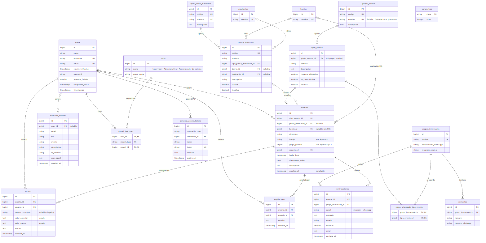
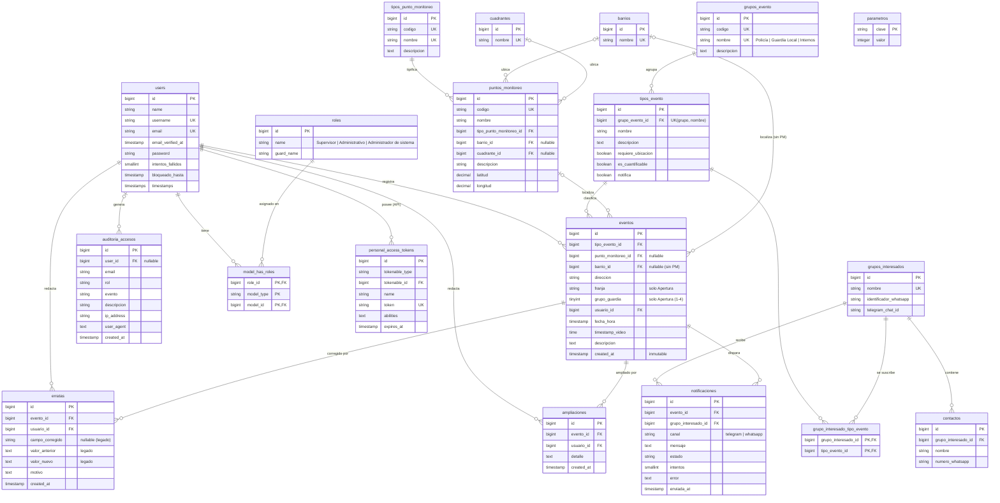

# DER — Diagrama Entidad-Relación

Esquema PostgreSQL actual (migraciones hasta `2026_11_11_000001_create_ampliaciones_table`).
Se omiten las tablas de infraestructura de Laravel (`cache`, `jobs`, `sessions`,
`password_reset_tokens`, `failed_jobs`) y las de permisos finos de spatie
(`permissions`, `role_has_permissions`, `model_has_permissions`).

Imagen generada con `npx @mermaid-js/mermaid-cli -i docs/der.md -o docs/der.svg`
(también `der.svg`). Fuente editable:

## Notas

- **Sin tabla de turnos.** El turno es un par de eventos internos (Apertura /
  Cierre de turno, grupo Internos); `franja` y `grupo_guardia` solo se cargan en
  la Apertura.
- **Inmutabilidad.** `eventos`, `erratas` y `ampliaciones` solo tienen
  `created_at`. Cada errata/ampliación genera además una constancia (evento
  interno Errata / Ampliación) en `eventos`.
- **Vista `eventos_vigentes`.** Misma forma que `eventos` con las correcciones de
  erratas legadas (campo/valor) aplicadas; la leen estadísticas, mapa,
  exportaciones y API.
- **Ubicación.** Con PM el barrio sale de `puntos_monitoreo.barrio_id`; sin PM
  se usa `eventos.barrio_id` + `direccion`.
- `parametros` es una tabla clave/valor de configuración, sin relaciones.
